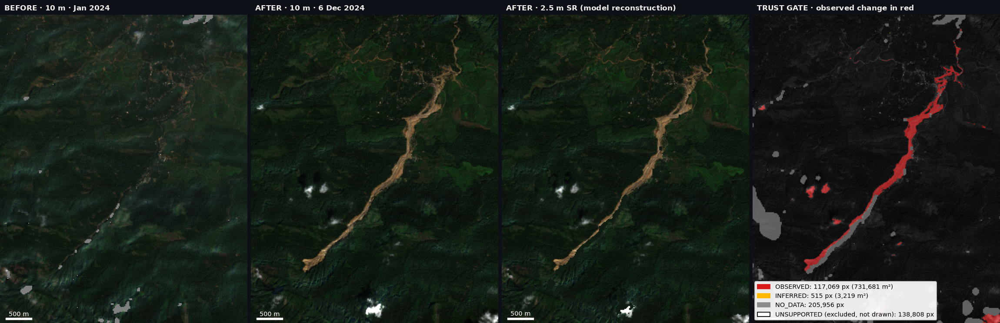
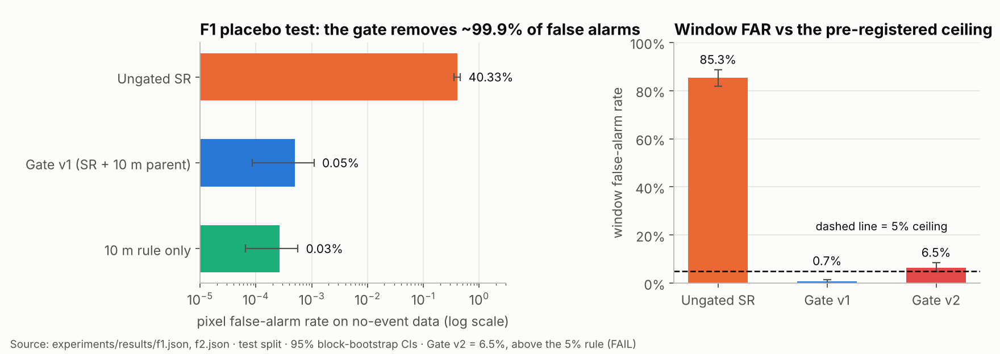
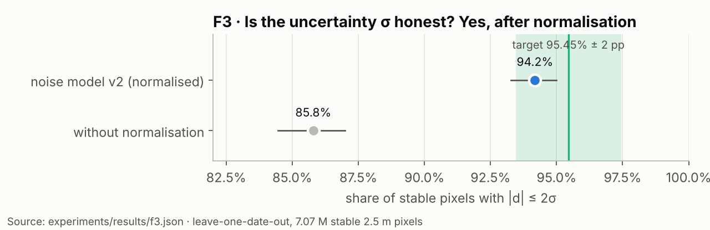
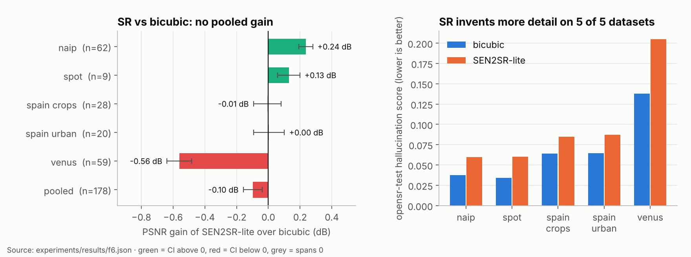
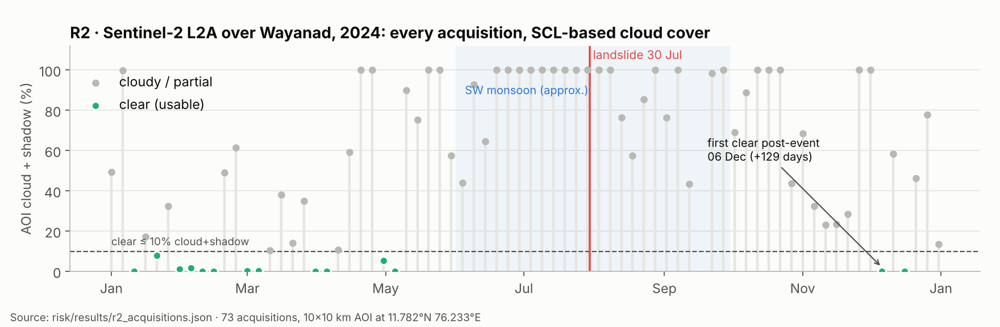
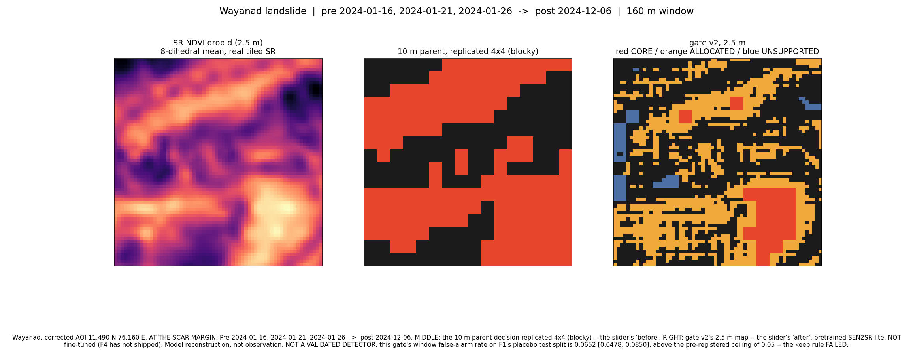
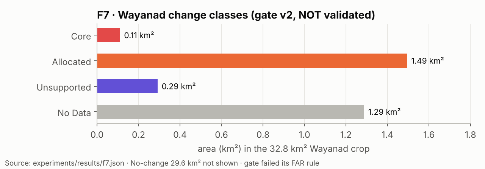
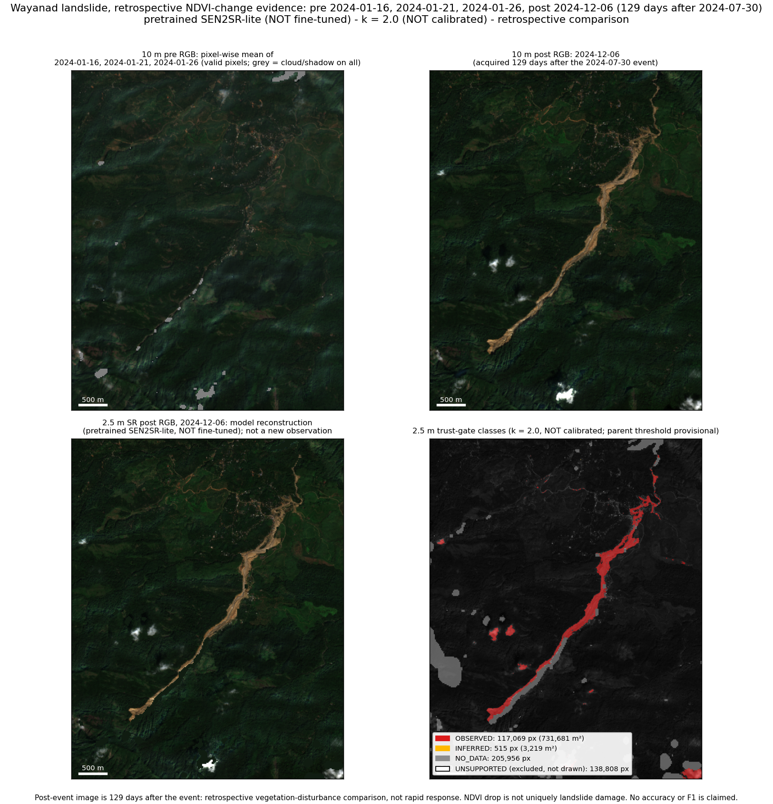

<h1 align="center">
   TrustSR
</h1>

<p align="center">
  <b>Sentinel-2 super-resolution (10 m → 2.5 m, ×4) with a trust gate for landslide change detection.</b><br>
  Every reported change is labelled <i>observed</i> or <i>model-inferred</i>, because an invented edge looks like damage.
</p>

<p align="center">
  
  
  
  
  
  
</p>

<p align="center">
  
  <br><sub>Wayanad, real Sentinel-2 data: before (mean of three Jan 2024 dates) → after (6 Dec 2024) → 2.5 m SR → trust gate. Pretrained SEN2SR-lite, k = 2.0 not yet calibrated. <a href="#media">More media ↓</a></sub>
</p>

---

**Smart India Hackathon · problem statement from NTRO.** The showcase event is the Wayanad landslide in Kerala, India.

> **The core idea.** Super-resolution invents detail. TrustSR runs SEN2SR-lite under all 8 dihedral transforms
> and across several clear pre-event dates. That gives every 2.5 m pixel an uncertainty, σ. A change is only
> reported as **OBSERVED** if it clears `k·σ` *and* its 10 m parent pixel also shows change. Change that only
> the SR model "sees" is logged as **UNSUPPORTED** and is never shown as damage.

## Project status

```
Phase 0  risk tests        ██████░░░░  3/5 pass   R1 shape FAIL · R5 fine-tune BLOCKED (0 steps)
Experiments F1–F7          ██████░░░░  4/6 pass   F2 gate v2 FAIL · F7 Wayanad map FAIL (inherits F2)
F11/F12 recalibration      ███░░░░░░░  in progress (stopped partway through Task 4 of 6)
Phase 1 modules            █░░░░░░░░░  research code in trustsr/, no fetch/sr/trust/change/evaluate yet
Streamlit demo             ░░░░░░░░░░  asset exporter only
```

| | Result | Verdict |
|---|---|:---:|
| **Imagery exists** (R2) | 12 clear pre-event dates. First clear post-event date is 2024-12-06, **129 days** after the event | ✅ |
| **Paired training data** (R3) | WorldStrat has 3,928 AOIs: **71 in India**, 125 in South Asia. 107 GB in total | ✅ |
| **Calibration labels** (R4) | Colombia pre/post sample (748 landslide pixels). Landslide4Sense available via a mirror | ✅ |
| **Model fits on the GPU** (R1) | 128 px tile: 0.12 s, 100 MiB. **512 px and 64 px tiles fail** the model's fixed Fourier mask | ❌ |
| **Fine-tune smoke test** (R5) | Real pairs prepared. **0 optimizer steps** run, no fine-tuned weights | ⛔ |
| **Trust gate on no-event data** (F1) | Pixel false-alarm rate drops from **40.3% to 0.05%** | ✅ |
| **Uncertainty is honest** (F3) | 94.2% coverage against a 95.45% target | ✅ |
| **Gate v2 false-alarm rule** (F2) | Window FAR **6.5%**, above the required ≤ 5% | ❌ |
| **SR beats bicubic** (F6) | **−0.10 dB** PSNR pooled, and it hallucinates more than bicubic on 5 of 5 datasets | ❌ |

Full claim table: [RESULTS_V2.md](RESULTS_V2.md) · Phase 0 details: [RISK_REPORT.md](RISK_REPORT.md)

## Results at a glance

All figures are generated from the committed result JSONs by [`scripts/make_figures.py`](scripts/make_figures.py). No number in them was typed in by hand.

### The trust gate works on no-event data


The placebo test treats two pre-event dates as "before" and "after", so any change it reports is a false alarm.
Ungated SR flags 40% of pixels. The gate flags 0.05%. Gate v2 misses its window-level ceiling by 1.5 points:
calibration and test windows come from one crop, so they aren't truly exchangeable.

### Its uncertainty estimate is calibrated


### SR itself is not sharper than bicubic, and it invents more


This is why the trust gate exists. Pretrained SEN2SR-lite only wins on NAIP and SPOT. NAIP may overlap with the
model's training data.

### Imagery: the monsoon hides the event for four months


### Wayanad, as the current (unvalidated) gate maps it



> ⚠ This map comes from gate v2, which **failed** its false-alarm rule, and from *pretrained* (not fine-tuned)
> SEN2SR-lite. It shows what this configuration produces, not a validated damage map.

## Media

| | |
|---|---|
| **Wayanad evidence board** (full resolution, 4 panels with legends)<br>[`experiments/wayanad_evidence/outputs/figure.png`](experiments/wayanad_evidence/outputs/figure.png) | **Gate v2 close-up** (SR NDVI drop, 10 m parent, 2.5 m classes)<br>[`experiments/results/f7_wow_figure.png`](experiments/results/f7_wow_figure.png) |
|  |  |

**Web demo screenshots.** The eight-screen web demo is on the `experiments/f13-discovery` branch (`demo/web/`). To
capture screenshots, run the demo, then run `python scripts/capture_screenshots.py`. They land in
`docs/media/screenshots/`. Add them here with ``.

Regenerate all media with `python scripts/make_figures.py && python scripts/make_hero.py`.

## How it works

```
Sentinel-2 L2A (B02 B03 B04 B08 + SCL)
        │  fetch: clear-date selection, one reference grid, COG stack
        ▼
SEN2SR-lite ×4, tiled 128 px, 8 dihedral runs × N pre-dates
        │  trust: per-run NDVI → per-pixel mean and σ
        ▼
d = NDVI_pre − NDVI_post,   σ = √(σ_pre² + σ_post²)
        │  change: compare with the 10 m parent pixel
        ▼
OBSERVED · INFERRED · UNSUPPORTED (logged) · NO_CHANGE · NO_DATA
```

Constraints: only the four 10 m bands, fine-tuning only (no training from scratch), and every GPU step fits in
4 GB with tiling. Outputs are COGs in the input CRS, with the 2.5 m grid aligned exactly to the 10 m grid.
Design detail: [docs/TRUSTSR_ARCHITECTURE.md](docs/TRUSTSR_ARCHITECTURE.md).

## Repository layout

| Path | What's there |
|---|---|
| `risk/` | Phase 0 risk probes R1–R5, with their evidence in `risk/results/` |
| `trustsr/` | Library code: placebo FAR harness, gate v2, noise model, bootstrap, sub-pixel allocation |
| `experiments/` | Experiment runners (E1–E8, F1–F11) and `experiments/results/` (JSON and reports). `INVALIDATED.md` lists quarantined runs |
| `configs/` | Pre-registered YAML configs. Every threshold lives here |
| `tests/` | CPU pytest suite |
| `scripts/` | CLI entry points: `make_figures.py`, `make_hero.py`, `capture_screenshots.py` |
| `demo/` | Demo asset exporter. The Streamlit app is not built yet |
| `pitch/` | Claims registry generated from result JSONs, for the jury deck |
| `notebooks/` | Colab fine-tuning notebook |
| `docs/` | Design, ADRs, sources, plans, logo and charts (`docs/assets/`), images and screenshots (`docs/media/`), superseded material (`docs/archive/`) |

## Quick start (Phase 0)

```bash
python -m venv .venv && source .venv/bin/activate      # Windows: .\.venv\Scripts\activate
pip install -r requirements-phase0.txt
pytest                                   # CPU-only tests
python -m risk.r1_model_fits             # R1 … R5: exit 0 = PASS, exit 2 = FAIL/BLOCKED
python -m risk.r2_imagery
python -m risk.r3_worldstrat
python -m risk.r4_labels
python -m risk.worldstrat_prepare && python -m risk.r5_finetune   # needs real pairs and Colab
python scripts/make_figures.py           # regenerate the README figures
```

The tested runtime is Windows 11 / Python 3.13 on an RTX 4050 Laptop GPU (6 GB). An exact Windows lock is in
[requirements-lock-windows.txt](requirements-lock-windows.txt). Colab steps are in
[the notebook](notebooks/colab_finetune.ipynb) and the [data contract](docs/r5_data_contract.md).

## How to reproduce the Wayanad demo

The demo is **not yet implemented**. What exists today:

1. Imagery audit: `python -m risk.r2_imagery` (12 clear pre-dates, post-date 2024-12-06).
2. Production rerun: `python -m experiments.f7_wayanad_v2`. It needs the cached 10 m stack under `data/` and
   writes `experiments/results/f7.json` and `f7_wow_figure.png`.
3. Demo assets: `python demo/export_assets.py` (needs the 2.5 m COGs in `experiments/wayanad_evidence/outputs/`).

Before the demo is built, these must be resolved: the gate's FAR (F11/F12), real-data fine-tuning (R5), and the
128 px-only tile policy (R1). The intended route is pinned inputs/weights → aligned 10 m COGs → tiled ×4 SR →
trust/change COGs → held-out evaluation → offline Streamlit demo.

## Documents

- [Project blueprint and acceptance gates](docs/project_blueprint.md) · [Design](docs/design.md) · [Architecture](docs/TRUSTSR_ARCHITECTURE.md)
- [NTRO problem statement](docs/problem_statement.md) · [SIH playbook strategy](docs/playbook_strategy.md) · [Research landscape](docs/landscape.md) · [Prior-art teardown](docs/prior_art_teardown.md)
- ADRs: [gate v2](docs/adr-f2-gate-v2.md) · [noise model](docs/adr-x5-noise-model.md) · [season latency](docs/adr-x6-season-latency.md)
- [Source register](docs/sources.md) · [Environment](docs/environment.md) · [Timeline](docs/timeline.md) · [Implementation ledger](docs/implementation-ledger.md)
- Archive: [RESULTS_EXCEPTIONAL.md (invalidated)](docs/archive/RESULTS_EXCEPTIONAL.md)

<sub>No accuracy, fine-tuning success or immediate disaster-response claim is established yet. Negative results are reported as they are.</sub>
